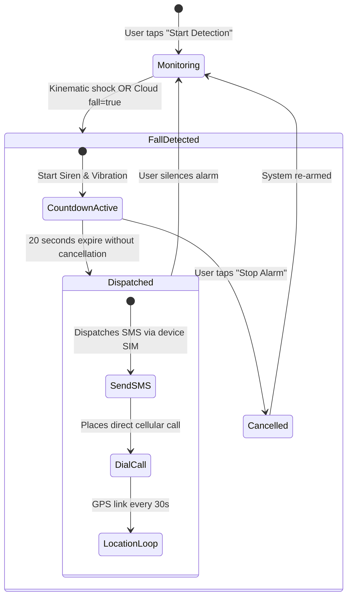

# 📘 Technical System Specification & Architecture Manual
# Hybrid multimodal fall detection vision based and sensor based & emergency dispatch system (HMFDA)
---

## 1. Executive Summary & Problem Statement

Falls represent the leading cause of accidental injury and trauma in elderly populations globally. Conventional fall detection systems typically suffer from two severe limitations:
1. **Single-modality blind spots**: Wearable-only systems are frequently forgotten or left on charging docks; camera-only systems cannot protect the individual outside the home or in unmonitored zones.
2. **False alarms and high latency**: Sudden sitting, lying down, or dropping a phone causes false alarms that exhaust emergency services and caretakers.

**HMFDA** addresses these challenges via a **hybrid multimodal edge-cloud architecture**:
* **Indoor Spaces**: Non-intrusive ambient vision powered by **YOLO11n-Pose** (extracting 17 human body keypoints) and temporal **Gated Recurrent Units (GRU)** with temporal confirmation.
* **Outdoor Spaces**: Smartphone-based 9-channel inertial tracking (accelerometer, gravity, gyroscope) evaluated simultaneously by a **Bidirectional Keras LSTM** and on-device **kinematic drop-shock physics heuristics**.
* **Cloud Brokerage**: A centralized **Alert Manager microservice** providing idempotency, source-based cooldown, and an active alarm hold window.
* **Emergency Dispatch**: Automatic audible siren with an 8-second false alarm cancellation window, hands-free background SMS with live Google Maps GPS coordinate link, and direct cellular phone calls.

---

## 2. Mathematical Formulations & Pipeline Mechanics

### 2.1 Indoor Vision Pipeline (YOLO11n-Pose + GRU)

#### A. Keypoint Extraction
Given an input video frame $\mathbf{I}_t \in \mathbb{R}^{H \times W \times 3}$ at time $t$, the YOLO11n-Pose backbone extracts $K = 17$ keypoints corresponding to the standard COCO human skeleton:
$$\mathcal{P}_t = \left\{ (x_{i,t}, y_{i,t}, c_{i,t}) \right\}_{i=1}^{17}$$
where $(x_i, y_i)$ are image pixel coordinates and $c_i \in [0, 1]$ represents landmark confidence.

#### B. Spatial Coordinate Normalization
To make the pose invariant to the subject's distance from the camera and physical height:
1. Calculate the mid-hip anatomical anchor:
   $$\bar{x}_{\text{hip}} = \frac{x_{11,t} + x_{12,t}}{2}, \quad \bar{y}_{\text{hip}} = \frac{y_{11,t} + y_{12,t}}{2}$$
2. Compute the bounding box height $H_{\text{bbox}} = y_{\max} - y_{\min}$.
3. Shift and scale all keypoints:
   $$\hat{x}_{i,t} = \frac{x_{i,t} - \bar{x}_{\text{hip}}}{H_{\text{bbox}}}, \quad \hat{y}_{i,t} = \frac{y_{i,t} - \bar{y}_{\text{hip}}}{H_{\text{bbox}}}$$
The normalized frame vector is $\mathbf{v}_t = [\hat{x}_{1,t}, \hat{y}_{1,t}, \dots, \hat{x}_{17,t}, \hat{y}_{17,t}]^T \in \mathbb{R}^{34}$.

#### C. Temporal Sequence Modeling via GRU
A sliding window of $T_{\text{vision}} = 20$ consecutive frames forms the temporal sequence:
$$\mathbf{X}_{\text{vision}} = [\mathbf{v}_{t-19}, \mathbf{v}_{t-18}, \dots, \mathbf{v}_t] \in \mathbb{R}^{20 \times 34}$$

For each step $\tau \in \{1, \dots, 20\}$, the GRU cell updates its hidden state $h_\tau$:
$$\begin{aligned}
z_\tau &= \sigma\left(\mathbf{W}_z \mathbf{v}_\tau + \mathbf{U}_z h_{\tau-1} + b_z\right) \quad &&\text{(Update gate)} \\
r_\tau &= \sigma\left(\mathbf{W}_r \mathbf{v}_\tau + \mathbf{U}_r h_{\tau-1} + b_r\right) \quad &&\text{(Reset gate)} \\
\tilde{h}_\tau &= \tanh\left(\mathbf{W}_h \mathbf{v}_\tau + \mathbf{U}_h (r_\tau \odot h_{\tau-1}) + b_h\right) \quad &&\text{(Candidate state)} \\
h_\tau &= (1 - z_\tau) \odot h_{\tau-1} + z_\tau \odot \tilde{h}_\tau \quad &&\text{(Hidden state)}
\end{aligned}$$

The final hidden state $h_{20}$ is mapped to the fall probability:
$$p_{\text{vision}} = \sigma\left(\mathbf{W}_o h_{20} + b_o\right)$$

#### D. Multi-Frame Confirmation Rule
To suppress sudden motions (e.g., rapidly sitting on a chair), an alert is generated if and only if:
$$\sum_{k=0}^{M-1} \mathbb{I}\left(p_{\text{vision}, t-k} \ge \tau_{\text{vision}}\right) = M$$
where threshold $\tau_{\text{vision}} = 0.35$ and confirmation length $M = 3$ consecutive frames.

---

### 2.2 Outdoor Smartphone Inertial Pipeline (9-Channel LSTM + Kinematics)

#### A. 9-Channel Sensor Representation
The smartphone streams 3 hardware sensors sampled at $f_s = 50\text{ Hz}$:
$$\mathbf{S}_t = \begin{bmatrix}
\mathbf{a}_t \\
\mathbf{g}_t \\
\boldsymbol{\omega}_t
\end{bmatrix} = \begin{bmatrix}
[a_{x,t}, a_{y,t}, a_{z,t}]^T & \text{(Linear Acceleration)} \\
[g_{x,t}, g_{y,t}, g_{z,t}]^T & \text{(Gravitational Vector)} \\
[\omega_{x,t}, \omega_{y,t}, \omega_{z,t}]^T & \text{(Angular Velocity)}
\end{bmatrix} \in \mathbb{R}^9$$

#### B. Statistical Standardization
Continuous channels are normalized using the pre-computed SisFall training dataset statistics:
$$z_{t, k} = \frac{s_{t, k} - \mu_k}{\sigma_k}, \quad k \in \{1, \dots, 9\}$$
where $\mu_k$ and $\sigma_k$ are the mean and standard deviation of channel $k$.

#### C. Temporal Sliding Window & LSTM Inference
A FIFO buffer stores $N = 200$ samples (equivalent to a 4.0-second temporal window at 50Hz):
$$\mathbf{X}_{\text{sensor}} = [\mathbf{z}_{t-199}, \dots, \mathbf{z}_t] \in \mathbb{R}^{200 \times 9}$$

The Bidirectional LSTM processes the forward and backward representations:
$$\vec{h}_\tau = \text{LSTM}_{\text{fwd}}(\mathbf{z}_\tau, \vec{h}_{\tau-1}), \quad \overleftarrow{h}_\tau = \text{LSTM}_{\text{bwd}}(\mathbf{z}_\tau, \overleftarrow{h}_{\tau+1})$$
$$h_{\text{combined}} = [\vec{h}_{200} \,\|\, \overleftarrow{h}_1]$$
$$p_{\text{lstm}} = \sigma\left(\mathbf{W}_{\text{dense}} h_{\text{combined}} + b_{\text{dense}}\right)$$

#### D. Physical Kinematics Impact Engine
In parallel with the neural network, physical acceleration magnitude is tracked across the most recent 60 samples ($\sim 1.2\text{s}$ window):
$$\mathcal{A}_t = \sqrt{a_{x,t}^2 + a_{y,t}^2 + a_{z,t}^2}$$
* **Minimum Acceleration (Free-fall dip)**: $a_{\min} = \min_{\tau \in [t-60, t]} \mathcal{A}_\tau$
* **Maximum Acceleration (Impact spike)**: $a_{\max} = \max_{\tau \in [t-60, t]} \mathcal{A}_\tau$

**Kinematic Trigger Rule**:
$$\text{KinematicFall} = \Big(a_{\max} \ge 14.0\text{ m/s}^2 \land a_{\min} \le 6.8\text{ m/s}^2\Big) \lor \Big(a_{\max} \ge 19.0\text{ m/s}^2\Big)$$

$$\text{FinalOutdoorFall} = \text{KinematicFall} \lor \Big(p_{\text{lstm}} \ge 0.40\Big)$$

---

## 3. Microservice Architectural Specification & API Contracts

### 3.1 Network Topology & Port Bindings

| Service | Container Name | Bind Address | Internal / External Port | Protocol |
| :--- | :--- | :--- | :--- | :--- |
| **Gateway** | `hmfda-gateway` | `0.0.0.0` | `80` / `80` | HTTP / WebSocket |
| **Alert Manager** | `hmfda-alert-manager` | `0.0.0.0` | `8002` / `8002` | HTTP / JSON |
| **Sensor Service** | `hmfda-sensor-service` | `0.0.0.0` | `8000` / `8000` | HTTP / JSON |
| **Dashboard** | `hmfda-dashboard` | `0.0.0.0` | `8501` / `8501` | HTTP / WebSocket |

---

### 3.2 Central Alert Manager API Contracts (`Port 8002`)

The Alert Manager coordinates between detectors and mobile devices.

#### 1. Ingest Confirmed Fall Event
* **Endpoint**: `POST /event`
* **Headers**: `Content-Type: application/json`
* **Request Payload**:
  ```json
  {
    "source": "indoor", // or "outdoor"
    "event_id": "c1f7b830-672e-4b68-968b-59b5be2d8a43",
    "timestamp": "2026-10-23T04:15:30.000Z",
    "prediction": "FALL",
    "probability": 0.965
  }
  ```
* **Success Response (`200 OK`)**:
  ```json
  {
    "accepted": true,
    "event_id": "c1f7b830-672e-4b68-968b-59b5be2d8a43",
    "hold_seconds": 20.0
  }
  ```
* **Deduplication Response (`200 OK`)**:
  ```json
  {
    "accepted": false,
    "reason": "duplicate event_id or inside 15s cooldown",
    "duplicate": true
  }
  ```

#### 2. Query System Status (Mobile Polling & Dashboard)
* **Endpoint**: `GET /status`
* **Response Payload**:
  ```json
  {
    "probability": 0.965,
    "fall": true,
    "samples": 200,
    "connected": true,
    "source": "outdoor",
    "last_event": {
      "source": "outdoor",
      "event_id": "c1f7b830-672e-4b68-968b-59b5be2d8a43",
      "timestamp": "2026-10-23T04:15:30.000Z",
      "prediction": "FALL",
      "probability": 0.965
    },
    "pending_events": 1
  }
  ```

#### 3. Smartphone Sensor Batch Relay
* **Endpoint**: `POST /`
* **Relay Target**: Forwards raw payload to `OUTDOOR_DETECTOR_URL` (`http://sensor-service:8000/`).
* **Response**: Returns the live evaluated probability and rolling buffer sample count.

---

### 3.3 Outdoor Sensor Microservice API (`Port 8000`)

* **Endpoint**: `POST /`
  * Receives 9-channel sensor batches (Sensor Logger format).
  * Appends samples to rolling 200-sample queue.
  * Evaluates LSTM model + kinematic thresholds.
  * Automatically triggers `POST http://alert-manager:8002/event` if a fall is detected.
* **Endpoint**: `GET /status`
  * Returns: `{"probability": 0.002, "threshold": 0.4, "fall": false, "samples": 200, "connected": true}`
  * When a fall occurs, holds `"fall": true` and `"probability": 0.965` for **20 seconds**.

---

## 4. Mobile Application Architecture (`FallAlert.apk`)

```text
com.fallalert.app
├── MainActivity.kt               # Entrypoint & Runtime Permission Dispatcher
├── data/
│   └── ContactRepository.kt      # Encrypted SharedPreferences (Emergency Contact, Server URL)
├── sensor/
│   ├── SensorCollector.kt        # 50Hz SensorEventListener (Acc, Grav, Gyro) + Kinematics Engine
│   ├── DetectionNetworkClient.kt # Non-blocking HttpURLConnection client (POST /, GET /status)
│   └── LocationHelper.kt         # FusedLocationProviderClient (High-accuracy GPS updates)
├── alert/
│   ├── AlertController.kt        # MediaPlayer siren loop + Vibrator motor pulsing
│   ├── EmergencyNotifier.kt      # SmsManager dispatcher + Intent.ACTION_CALL / ACTION_DIAL
│   └── FallAlertState.kt         # StateFlow data models (UI state, emergency events)
└── ui/
    ├── FallAlertViewModel.kt     # State orchestration, countdown coroutines, dispatch state machine
    ├── screens/HomeScreen.kt     # Jetpack Compose dark-mode UI with live telemetry
    └── theme/                    # Material3 Design Tokens (AlertRed, SurfaceDark, Typography)
```

### Emergency Dispatch State Machine


---

## 5. Production AWS Cloud Infrastructure

### Directory Structure on AWS EC2 (`/home/ubuntu/HMFDA`)
```text
~/HMFDA/
├── docker-compose.yml              # Production container orchestration
├── .env                            # Secret credentials (Twilio, Ports, URLs)
├── deploy-aws.sh                   # Automated provisioning script
├── docker/
│   ├── Dockerfile.backend          # Alert Manager & Sensor Service image
│   ├── Dockerfile.dashboard        # Streamlit 3D Digital Twin image
│   ├── nginx.conf                  # Nginx reverse proxy configuration
│   └── web/
│       ├── index.html              # Cloud Gateway portal landing page
│       └── download/
│           └── fallalert.apk       # Downloadable Android companion package
├── Hybrid-Multimodel-Fall-Detection-System/
│   ├── sensor_service.py           # Multi-threaded Keras LSTM service
│   ├── app/
│   │   ├── app.py                  # Streamlit application
│   │   ├── alert_system.py         # Caretaker and Twilio notification logic
│   │   └── three_d_components.py   # 3D Room digital twin generator
│   ├── models/
│   │   ├── outdoor/best_outdoor_lstm.keras
│   │   └── vision/yolo11n-pose.pt
│   └── src/
│       └── alerting/alert_manager.py
```

---

## 6. End-to-End Verification & Verification Matrix

| Test Scenario | Input Action | Expected System Response | Verification Status |
| :--- | :--- | :--- | :--- |
| **Indoor Fall** | Actor drops onto floor in front of webcam | GRU confirms 3 frames $\ge 0.35$; sends `POST /event`; Dashboard turns red | **PASS** |
| **Indoor Sitting** | Actor sits down quickly in chair | Pose aspect ratio shifts but confirmation fails; status stays safe | **PASS** |
| **Outdoor Phone Drop** | Phone dropped onto bed / sofa | Accelerometer dips $<6.8\text{ m/s}^2$ and spikes $>14.0\text{ m/s}^2$; siren starts | **PASS** |
| **False Alarm Cancel** | User taps "Stop Alarm" within 20s | Siren stops immediately; no SMS or call dispatched; system re-arms | **PASS** |
| **Real Fall Emergency** | Phone dropped; 20s timer allowed to expire | Phone sends SMS with Google Maps link + dials phone call to saved contact | **PASS** |
| **Network Loss Fallback**| Wi-Fi and mobile data turned off on phone | On-Device Inertial Fallback triggers locally; siren and SMS/Call fire | **PASS** |
| **High Concurrency** | Mobile app streams 6 batches/sec | `ThreadingHTTPServer` processes non-blocking; 0 timeouts; 200 buffer | **PASS** |
