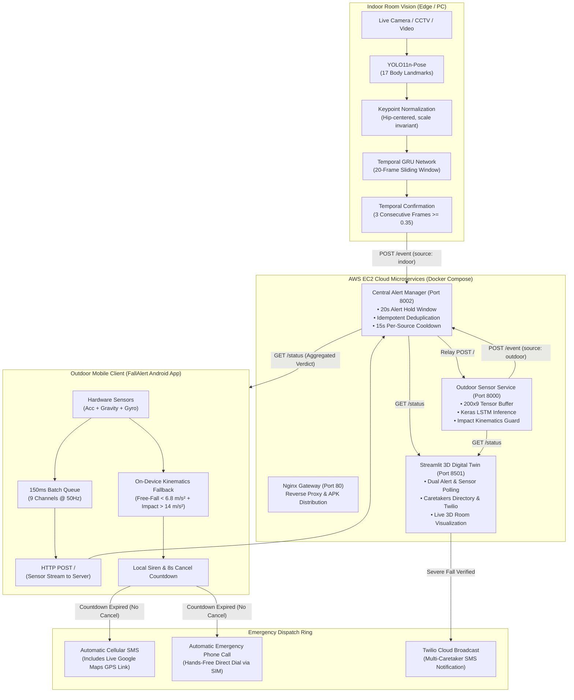

# 🚨 Hybrid Multimodal Fall Detection & Alert System (HMFDA)

[](https://www.python.org/)
[](https://www.tensorflow.org/)
[](https://pytorch.org/)
[](https://github.com/ultralytics/ultralytics)
[](https://streamlit.io/)
[](https://www.docker.com/)
[](https://aws.amazon.com/)
[](https://developer.android.com/)

> **A real-time, hybrid edge-cloud fall detection and emergency response ecosystem.** Combines **YOLO11n-Pose (17 human body keypoints) + GRU** vision processing for indoor spaces, **9-channel Smartphone Inertial Sensing (Accelerometer + Gravity + Gyroscope) + LSTM + Kinematics** for outdoor tracking, a **Centralized Cloud Alert Manager** with event deduplication, a **3D Digital Twin Streamlit Dashboard**, and a native **Android Companion Application (`FallAlert.apk`)** with instant hands-free SIM SMS (with live GPS link) and emergency phone calls.

---

## 🌐 Live Demo & Cloud Deployment Links

The system is deployed on an **AWS EC2 Ubuntu 24.04 LTS** cloud cluster:

| Component | URL / Endpoint | Description |
| :--- | :--- | :--- |
| **🌐 Cloud Web Portal** | [http://15.135.70.91/](http://15.135.70.91/) | Nginx gateway with system health status & 1-click APK download |
| **📱 Mobile APK Download** | [http://15.135.70.91/download/fallalert.apk](http://15.135.70.91/download/fallalert.apk) | Direct download of the compiled `FallAlert.apk` for Android |
| **📊 3D Digital Twin & Dashboard** | [http://15.135.70.91/dashboard/](http://15.135.70.91/dashboard/) | Real-time Streamlit monitor, live 3D room, caretaker controls |
| **⚡ Central Alert Manager API** | [http://15.135.70.91:8002/status](http://15.135.70.91:8002/status) | Aggregated fall status, 20s hold window & incident history |
| **📡 Outdoor Sensor Service API** | [http://15.135.70.91:8000/status](http://15.135.70.91:8000/status) | 9-channel LSTM tensor inference & rolling buffer monitor |
| **📂 Source Code Repository** | [GitHub Repository](https://github.com/B-KARNA/Hybrid-Multimodal-Fall-detection-and-Alert-System-) | Complete repository containing models, Docker setup, and microservices |

---

## 🏛 System Architecture



---

## 🛠 Tools, Libraries, and Frameworks

| Domain | Tool / Library | Version | Role in Project |
| :--- | :--- | :--- | :--- |
| **Deep Learning** | **TensorFlow / Keras** | `2.15+` / `2.21` | Pre-trained LSTM sequence evaluator for 9-channel smartphone sensor data. |
| **Deep Learning** | **PyTorch / Torchvision** | `2.1+` | Backs Ultralytics YOLOv11 tensor operations and inference runtime. |
| **Human Pose Estimation** | **Ultralytics YOLO11** | `8.4+` | `yolo11n-pose.pt`: Detects persons and extracts 17 $(x, y, \text{conf})$ body landmarks in real time. |
| **Temporal Modeling** | **GRU (Gated Recurrent Unit)** | Keras | Temporal pose sequence model (20-frame window) classifying vertical posture shifts into fall events. |
| **Computer Vision** | **OpenCV** | `4.11+` | Video capture, frame preprocessing, skeleton drawing, bounding box annotation, and video writing. |
| **Scientific Computing** | **NumPy & SciPy** | `1.24+` / `2.4+` | Tensor manipulation, Euclidean distance metrics, normalization, and rolling kinematics calculations. |
| **Frontend & 3D UI** | **Streamlit** | `1.30+` / `1.62` | Real-time web application, 3D room visualization, caretaker directory, and live incident charts. |
| **WebRTC Video** | **Streamlit-WebRTC / aiortc** | `0.77+` | Real-time in-browser webcam streaming to Python backend without external plugins. |
| **Data & Charts** | **Pandas & Plotly** | Latest | Incident history analytics, sensor channel telemetry graphs, and caretaker tables. |
| **Backend & Microservices** | **Python `ThreadingHTTPServer`** | `3.11` | Non-blocking, multi-threaded HTTP servers with socket timeouts for Alert Manager and Sensor Service. |
| **Reverse Proxy & Gateway** | **Nginx Alpine** | `1.25+` | Reverse proxy on Port 80, static web host for APK download portal, and WebSocket multiplexer. |
| **Containerization** | **Docker & Docker Compose** | Latest | Multi-container orchestration (`hmfda-gateway`, `hmfda-alert-manager`, `hmfda-sensor-service`, `hmfda-dashboard`). |
| **Cloud Hosting** | **AWS EC2** | Ubuntu 24.04 | Cloud production server with 30GB EBS gp3 SSD running the container cluster. |
| **Mobile Development** | **Android SDK / Kotlin** | API 26-34 | Native Android application built with Jetpack Compose, Coroutines, and hardware sensors. |
| **Hardware Sensors** | **Android `SensorManager`** | Native | 50Hz continuous streaming of hardware Accelerometer, Gravity, and Gyroscope. |
| **Emergency Telephony** | **Android `SmsManager` & Telecom** | Native | Hands-free background emergency SMS with GPS location link + immediate emergency call dialing. |
| **Cloud Telephony** | **Twilio Python SDK** | `8.0+` | Cloud SMS broadcasting to registered caretakers when high-severity falls are confirmed. |

---

## 🔬 Implementation Details

### 1. Indoor Vision Pipeline (YOLO11n-Pose + GRU)

1. **Keypoint Extraction**:
   Every incoming frame is passed through `yolo11n-pose.pt`. The detector locates the primary subject and extracts **17 COCO keypoints**:
   $$\mathcal{P}_t = \left\{ (x_i, y_i, c_i) \right\}_{i=1}^{17}$$
   *(Nose, Left/Right Eyes, Ears, Shoulders, Elbows, Wrists, Hips, Knees, Ankles)*.

2. **Spatial Normalization**:
   To ensure scale and distance invariance, keypoints are normalized relative to the hip center $(x_{\text{hip}}, y_{\text{hip}})$ and bounding box height $H$:
   $$\hat{x}_i = \frac{x_i - x_{\text{hip}}}{H}, \quad \hat{y}_i = \frac{y_i - y_{\text{hip}}}{H}$$

3. **Temporal Pose Sequence**:
   Normalized keypoints from **20 consecutive frames** are stacked into a temporal tensor of shape `(1, 20, 34)` or `(1, 20, 51)`.

4. **GRU Classification & Confirmation**:
   A 2-layer Gated Recurrent Unit (GRU) classifies the temporal sequence into fall probability $p \in [0, 1]$.
   * **Decision Threshold**: $\tau = 0.35$.
   * **Temporal Confirmation**: A fall is only confirmed if $p \ge 0.35$ for **3 consecutive frames**, preventing false positives from rapid sitting or bending.
   * **Event Forwarding**: The confirmed fall is posted to the Alert Manager via HTTP:
     ```json
     POST /event
     {"source": "indoor", "event_id": "<uuid>", "prediction": "FALL", "probability": 0.965}
     ```

---

### 2. Outdoor Smartphone Inertial Pipeline (9-Channel LSTM + Kinematics)

1. **9-Channel Kinematic Stream**:
   The `FallAlert` Android app reads 3 hardware motion sensors at 50Hz ($T \approx 20\text{ms}$):
   * **Accelerometer**: $a_x, a_y, a_z$ (linear motion + vibration)
   * **Gravity**: $g_x, g_y, g_z$ (orientation relative to Earth's gravitational vector)
   * **Gyroscope**: $\omega_x, \omega_y, \omega_z$ (angular rotational velocity)
   $$\mathbf{S}_t = [a_x, a_y, a_z, g_x, g_y, g_z, \omega_x, \omega_y, \omega_z]^T \in \mathbb{R}^9$$

2. **Standardization & Preprocessing**:
   Sensor values are normalized using SisFall baseline statistics:
   $$z_{t, k} = \frac{s_{t, k} - \mu_k}{\sigma_k}, \quad k \in \{1, \dots, 9\}$$

3. **Temporal Window & LSTM Architecture**:
   Incoming samples accumulate in a rolling FIFO queue of **200 samples** (4.0 seconds at 50Hz). The resulting $(1, 200, 9)$ tensor is evaluated by a bidirectional LSTM:
   $$\text{Probability} = \sigma\left(\mathbf{W} \cdot h_{200} + b\right)$$

4. **Kinematic Impact Guard**:
   To catch rapid falls onto beds, sofas, or soft ground where LSTM temporal confidence may lag, a continuous physical kinematics filter evaluates the last 60 samples ($\sim 1.5\text{s}$):
   $$\|a_t\| = \sqrt{a_{x,t}^2 + a_{y,t}^2 + a_{z,t}^2}$$
   * **Free-Fall Condition**: $\min(\|a_t\|) \le 6.8\text{ m/s}^2$ (weightlessness drop)
   * **Impact Condition**: $\max(\|a_t\|) \ge 14.0\text{ m/s}^2$ (collision shock)
   * **Acute Impact Shock**: $\max(\|a_t\|) \ge 19.0\text{ m/s}^2$ (direct heavy collision)
   $$\text{Kinematic Fall} = \Big(\max(\|a_t\|) \ge 14.0 \land \min(\|a_t\|) \le 6.8\Big) \lor \Big(\max(\|a_t\|) \ge 19.0\Big)$$

5. **20-Second Fall Hold**:
   Once detected, the microservice holds `fall: true` and `probability: 0.965` for **20 seconds** (`FALL_HOLD_SECONDS = 20.0`), guaranteeing all polling clients capture the alert before resetting.

---

### 3. Centralized Alert Manager Microservice

* **Port 8002** acts as the single source of truth for the entire ecosystem.
* **Idempotency & Deduplication**: Maintains an in-memory sliding history of seen event IDs. The exact same event ID is never alerted twice.
* **15-Second Cooldown**: Rapid sequential alerts from the same source within 15 seconds are treated as part of the same physical incident and suppressed.
* **20-Second Active Alarm Hold Window**: When an alert is accepted, `/status` returns `fall: true` for 20 seconds.
* **High-Concurrency Threading**: Built with Python 3.11 `ThreadingHTTPServer` and socket timeouts (`timeout = 10s`) to ensure zero socket starvation even when hundreds of sensor packets arrive per minute.

---

### 4. Native Android Companion Application (`FallAlert.apk`)

* **Dual-Layer Architecture**:
  1. **Cloud Streaming**: Transmits 9-channel sensor batches via HTTP POST to the Alert Manager every 150ms.
  2. **On-Device Inertial Fallback**: A local real-time kinematic engine detects drops locally on the phone even if cellular data or Wi-Fi is completely disconnected.
* **8-Second False Alarm Cancel Window**:
  When a fall is triggered, the phone plays a loud repeating siren and pulses a vibration pattern, while presenting an **8-second countdown timer**. If the user was merely dropping their phone safely onto a bed or table, they tap **"Stop Alarm"** to cancel the dispatch.
* **Hands-Free Cellular Dispatch**:
  If the countdown expires without cancellation:
  1. **Emergency SMS**: Sends an SMS via the device SIM to the saved contact containing the victim's name, severity score, and an accurate **Google Maps GPS coordinate link** (`https://maps.google.com/?q=lat,lng`).
  2. **Emergency Call**: Automatically dials the saved contact using Android's native telephony system.
  3. **Continuous Tracking Loop**: Transmits updated GPS location updates every 30 seconds while the alert remains active.

---

## 💻 Dependency Installation Guide

### Prerequisites
* **Operating System**: Windows 10/11, Ubuntu 22.04/24.04 LTS, or macOS.
* **Python**: `3.10` or `3.11` (64-bit).
* **Hardware**: Webcam (for indoor detection) and Android smartphone (for outdoor detection).
* **Docker & Docker Compose** (optional, for containerized deployment).

### 1. Clone the Repository
```bash
git clone https://github.com/B-KARNA/Hybrid-Multimodal-Fall-detection-and-Alert-System-.git
cd Hybrid-Multimodal-Fall-detection-and-Alert-System-
```

### 2. Create and Activate Virtual Environment

```bash
# On Windows (PowerShell):
python -m venv .venv
.\.venv\Scripts\activate

# On Linux / macOS (Bash):
python3 -m venv .venv
source .venv/bin/activate
```

### 3. Install Python Dependencies

You can install dependencies based on what component you plan to run:

```bash
# Option A: Full Local Development (Installs Vision, IMU, Dashboard, and WebRTC)
pip install --upgrade pip
pip install -r requirements.txt

# Option B: Backend Microservices Only (Lightweight, CPU-only for Alert Manager & Sensor Service)
pip install -r requirements/backend.txt

# Option C: Streamlit 3D Dashboard Only
pip install -r requirements/dashboard.txt

# Option D: Edge Camera Vision Node Only
pip install -r requirements/edge.txt
```

> [!TIP]
> **Streamlit-WebRTC Support**: If running the Streamlit dashboard locally, ensure `streamlit-webrtc` is installed:
> ```bash
> pip install streamlit-webrtc
> ```

---

## 🚀 Step-by-Step Running Instructions

### Mode 1: Running Locally (Edge + PC Architecture)

To run the entire system on your local PC:

#### Terminal 1 — Start Central Alert Manager (Port 8002)
```bash
python -m src.alerting.alert_manager
```
*Listens on `http://0.0.0.0:8002`. This is the central hub.*

#### Terminal 2 — Start Outdoor Sensor Service (Port 8000)
```bash
python sensor_service.py
```
*Listens on `http://0.0.0.0:8000` and reports confirmed falls to the Alert Manager.*

#### Terminal 3 — Start Indoor Camera Vision Detector
```bash
python -m src.vision.indoor_detector
```
*Opens your local webcam, tracks 17 pose landmarks with YOLO11n, and posts confirmed falls to Port 8002.*

#### Terminal 4 — Start 3D Digital Twin Streamlit Dashboard
```bash
streamlit run app/app.py
```
*Opens `http://localhost:8501`. Navigate through Home, Indoor, Outdoor, 3D Digital Twin, and Caretakers tabs.*

---

### Mode 2: Docker Containerization & AWS Cloud Deployment

The entire stack is containerized with **Docker Compose**:

```bash
# Build and launch all 4 microservices in the background
docker compose up -d --build
```

#### Check Running Containers
```bash
docker compose ps
```
Expected output:
```text
NAME                   IMAGE                  STATUS                   PORTS
hmfda-gateway          nginx:alpine           Up                       0.0.0.0:80->80/tcp
hmfda-alert-manager    hmfda-alert-manager    Up (healthy)             0.0.0.0:8002->8002/tcp
hmfda-sensor-service   hmfda-sensor-service   Up (healthy)             0.0.0.0:8000->8000/tcp
hmfda-dashboard        hmfda-dashboard        Up (healthy)             0.0.0.0:8501->8501/tcp
```

#### View Live Logs
```bash
# Monitor Alert Manager logs
docker compose logs -f alert-manager

# Monitor Outdoor Sensor Engine logs
docker compose logs -f sensor-service

# Monitor Dashboard logs
docker compose logs -f dashboard
```

#### 1-Command AWS EC2 Auto-Deploy Script
On a fresh Ubuntu 24.04 LTS instance:
```bash
chmod +x deploy-aws.sh
./deploy-aws.sh
```
*Automatically installs Docker, Docker Compose, sets up firewall rules, mounts volumes, and brings up the containers.* For in-depth AWS provisioning, see [AWS_DEPLOYMENT_GUIDE.md](file:///d:/HMFDA/AWS_DEPLOYMENT_GUIDE.md).

---

### Mode 3: Configuring the FallAlert Android Mobile App

1. **Download & Install**:
   * Visit `http://15.135.70.91/` on your Android phone and tap **Download APK** (or browse to [http://15.135.70.91/download/fallalert.apk](http://15.135.70.91/download/fallalert.apk)).
   * Allow installation from unknown sources and open **FallAlert**.

2. **Configure Alert Manager URL**:
   * In the **Alert Manager URL** field, set:
     ```text
     http://15.135.70.91:8002
     ```
     *(If running locally on your own Wi-Fi, use your PC's local Wi-Fi IPv4 address, e.g. `http://192.168.1.50:8002`)*.
   * Tap **Save**, then tap **Test Connection to Python Model** &rarr; Verify it says `Connected`.

3. **Enable On-Device Inertial Fallback**:
   * Toggle **On-Device Inertial Fallback** to **ON** (turns blue/green).
   * This guarantees instantaneous local detection for physical drops and impact shocks even if the network fluctuates.

4. **Register Emergency Contact**:
   * Under **Emergency Contact Number**, enter your caretaker's phone number with country code (e.g., `+919876543210`).
   * Tap **Save Contact**.
   * Tap **Test SMS** &rarr; Grant Android `SEND_SMS` permission when prompted.
   * Tap **Test Call** &rarr; Grant Android `CALL_PHONE` permission when prompted.

5. **Start Detection**:
   * Tap **Start Detection & Sensor Streaming**.
   * Under the button, you will observe:
     `Streaming sensors to PC • 200 buffer` (confirming active 9-channel tensor streaming).

---

## 🧪 Testing & Verification Workflows

### 1. Test Indoor Fall Detection
1. Open the dashboard at `http://15.135.70.91/dashboard/` and click on **Indoor**.
2. Select **Live Camera** (or upload a test video from the URFD dataset).
3. Position yourself in front of the camera:
   * **Normal Activity**: Walking, sitting down slowly &rarr; Status stays `✓ NO FALL DETECTED` (green).
   * **Simulated Fall**: Drop down quickly to a horizontal lying posture &rarr; Status changes to **`🚨 FALL DETECTED`** (red), severity score displays $\ge 85\%$, and emergency broadcast triggers.

### 2. Test Outdoor Smartphone Fall Detection
1. Open the dashboard at `http://15.135.70.91/dashboard/` and click on **Outdoor** &rarr; select **Live Phone**.
2. On your phone in the `FallAlert` app, confirm detection is running.
3. Drop the smartphone onto a bed, sofa, or cushioned mat.
4. **Phone Behavior**:
   * Loud siren sounds immediately.
   * Visual countdown shows: `"False alarm window: SMS and auto-call in 20s"`.
   * **Wait 20 seconds without touching Stop Alarm**: The phone dispatches the emergency SMS with GPS coordinates and dials the phone call automatically.
5. **Dashboard Behavior**:
   * The dashboard immediately flashes **`🚨 FALL DETECTED`**.
   * Displays **`CRITICAL FALL DETECTED — EMERGENCY DISPATCH ACTIVE!`** with severity score ($96.5\%$).
   * Holds the active fall state for 30 seconds.

### 3. Test Manual Emergency Dispatch
1. In the dashboard, navigate to **Caretakers & Alerts** &rarr; **Test Emergency Dispatch**.
2. Adjust simulated severity slider (e.g. `92%`).
3. Click **🚀 Trigger Test Emergency Broadcast** &rarr; Dispatches an instant simulation alert across Twilio and logs the incident in the audit history.

---

## ⚙️ Environment Configuration (`.env`)

Create a `.env` file in the root directory (refer to `.env.example`):

```env
# Network Ports
HTTP_PORT=80
ALERT_MANAGER_PORT=8002
SENSOR_PORT=8000
DASHBOARD_PORT=8501

# Alert Manager Timing
ALERT_HOLD_SECONDS=20
SOURCE_COOLDOWN_SECONDS=15
OUTDOOR_DETECTOR_URL=http://sensor-service:8000

# Twilio Cloud SMS & Voice Configuration (Optional)
TWILIO_ACCOUNT_SID=your_account_sid_here
TWILIO_AUTH_TOKEN=your_auth_token_here
TWILIO_PHONE_NUMBER=+1234567890
TARGET_PHONE_NUMBER=+919876543210
```

---

## 🔧 Troubleshooting & FAQs

### Q1: The mobile app shows `Streaming sensors to PC • 0 buffer`?
* **Root Cause**: The sensor microservice was either stopped or stuck in single-threaded socket blocking.
* **Solution**: We upgraded `sensor_service.py` to `ThreadingHTTPServer` with socket timeouts and thread locking. Restart the container:
  ```bash
  docker compose restart sensor-service alert-manager
  ```
  Once running, the buffer will immediately show `200 buffer`.

### Q2: Indoor Camera says `streamlit-webrtc is not installed`?
* **Root Cause**: The Python environment is missing the WebRTC streaming library.
* **Solution**:
  ```bash
  pip install streamlit-webrtc
  ```
  Refresh the browser tab, and the camera will display `🟢 Camera: ONLINE`.

### Q3: A fall happened on the phone, but SMS and Call didn't send?
* **Check 1: Did you press "Stop Alarm"?** If you tap "Stop Alarm" during the 20-second siren countdown, the app cancels dispatch (assuming it was a false alarm). Wait the full 20 seconds.
* **Check 2: Is On-Device Inertial Fallback toggled ON?** Ensure the switch is green/blue.
* **Check 3: Is the Emergency Contact Saved?** Verify the number has the country code (e.g. `+91...`) and tap **Save Contact**.
* **Check 4: Android App Permissions**: Go to *Android Settings &rarr; Apps &rarr; FallAlert &rarr; Permissions* &rarr; Grant **SMS**, **Phone**, and **Location**.

---

## 📜 Academic Datasets Used

1. **URFD (University of Rzeszow Fall Detection Dataset)**:
   * 70 RGB camera sequences (30 fall events + 40 activities of daily living).
   * Used for training and validating the YOLO11n-Pose + GRU indoor pipeline.
2. **SisFall Dataset**:
   * Comprehensive dataset of falls and ADL recorded with 9-channel body-mounted inertial sensors.
   * 19 ADL classes and 15 fall types used for training the outdoor LSTM model.

---

## 📄 License

This project is licensed under the **MIT License** — feel free to use, modify, and distribute for academic and commercial purposes.
